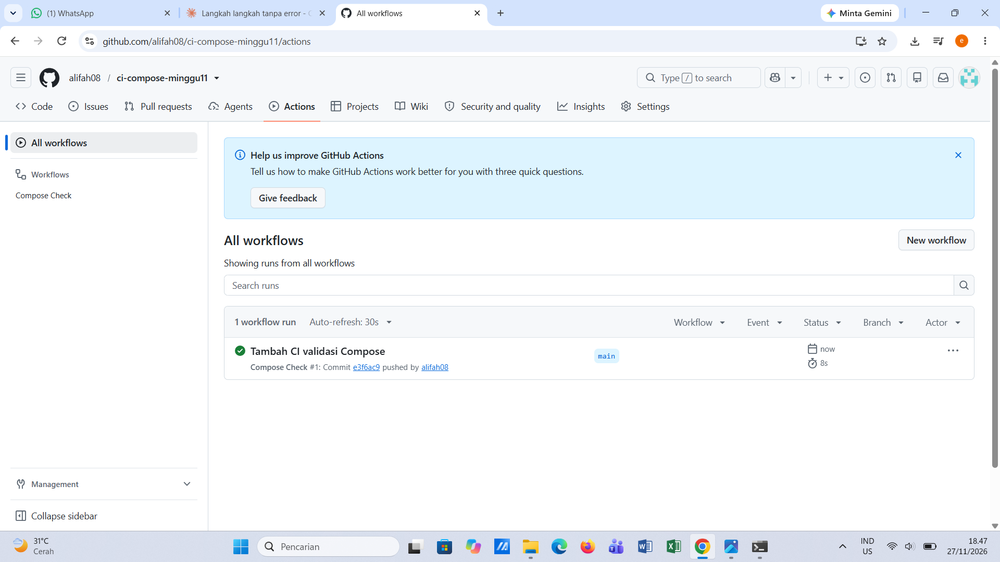
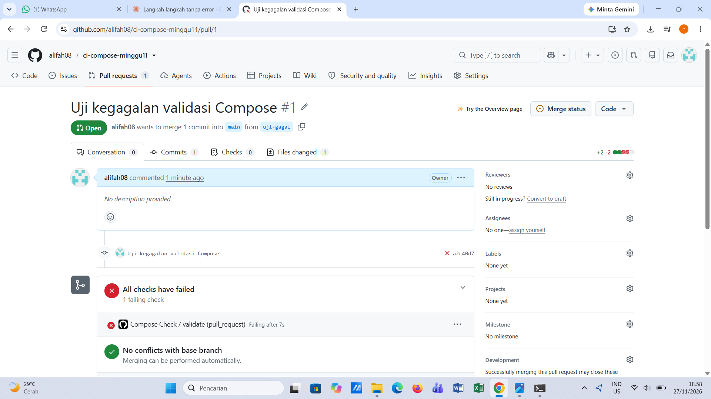
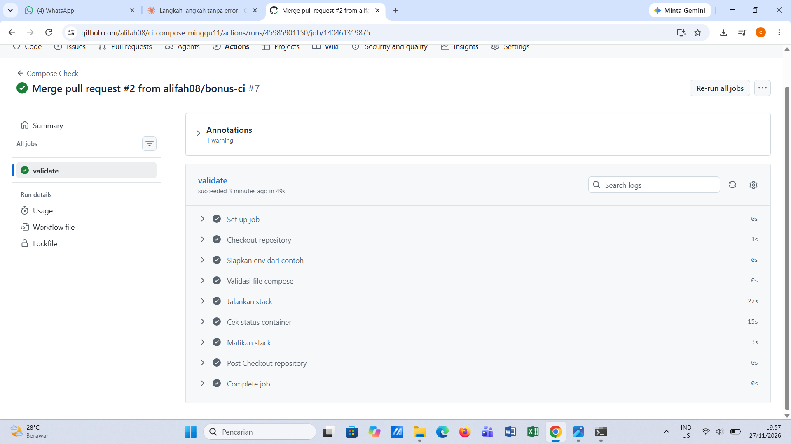

# Tugas Minggu 11: CI untuk Repo Compose

**Nama:** Alifah Windy Khairiya
**NIM:** 202557201004
**Mata Kuliah:** Teknologi Open Source

## Deskripsi

Proyek ini menggunakan GitHub Actions untuk memvalidasi konfigurasi Docker Compose WordPress dan MariaDB.
Pemeriksaan berjalan otomatis setiap ada push ke branch `main` dan setiap ada Pull Request.

## Isi Repositori

- `docker-compose.yml`: konfigurasi WordPress dan MariaDB
- `.env.example`: contoh variabel lingkungan
- `.github/workflows/compose-check.yml`: workflow validasi Compose
- `bukti/`: screenshot bukti CI

## Bukti

### 1. Run berhasil (hijau)

### 2. Pull Request gagal (merah)

Tautan Pull Request: https://github.com/alifah08/ci-compose-minggu11/pull/1

### 3. Bonus: up, ps, dan down di CI

Workflow menjalankan `docker compose up -d`, `docker compose ps`, dan `docker compose down -v` langsung di GitHub Actions.
